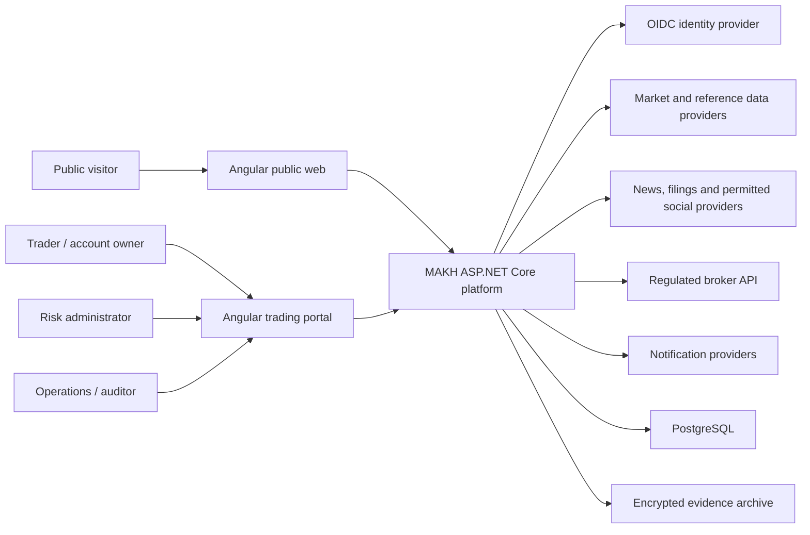
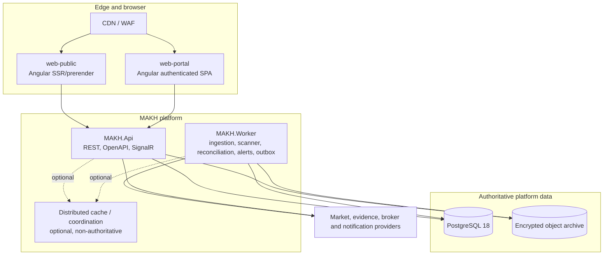
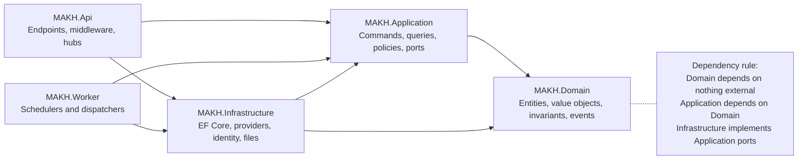
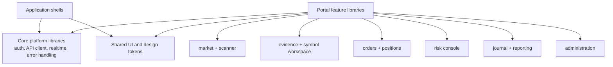
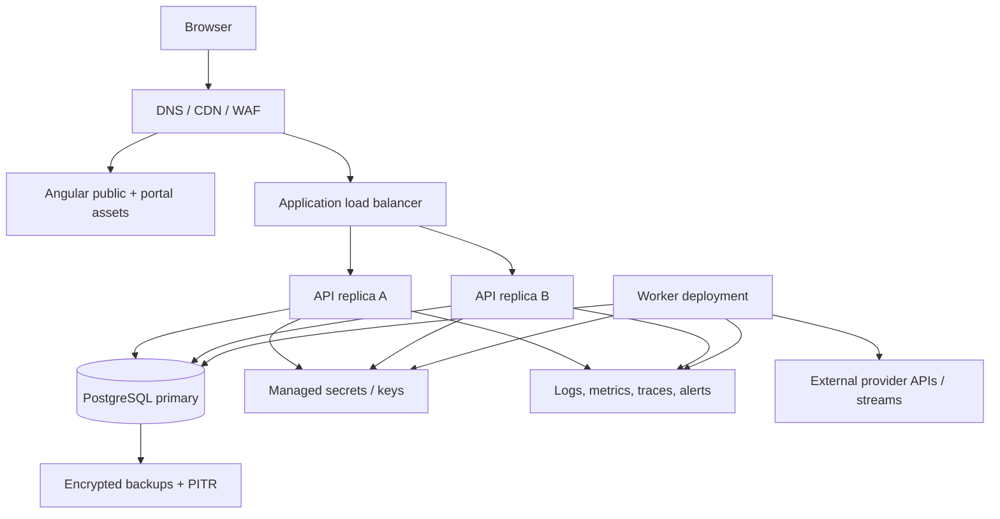

# MAKH Trading Platform — System Architecture

Status: Baseline v1.0  
Date: 12 August 2026  
Related requirements: FSD sections 2, 3, 7–19

## 1. Architecture objectives

- Enforce authorization and risk policy before any broker submission.
- Isolate business rules from web frameworks, databases and vendors.
- Preserve an auditable chain from market evidence through final execution.
- Recover safely from stale data, network faults, duplicate delivery and unknown broker state.
- Deliver a maintainable first release without premature distributed-system complexity.
- Preserve extraction boundaries for data ingestion, scanning and broker connectivity if measured scale requires them.

## 2. System context

### System responsibilities

The MAKH platform owns product configuration, scanner calculations, risk policy, order intent, normalized broker state, journal, reporting and audit evidence. It does not custody funds or securities. The selected broker owns accepted orders, executions, live positions and buying-power truth. External content providers own their market and evidence records subject to contractual rights.

## 3. Container view

### Container rules

- `web-public` contains no authenticated trading capability.
- `web-portal` can propose actions but cannot authorize itself; the server is authoritative.
- `MAKH.Api` is stateless with respect to user sessions except for explicitly approved server-side session state.
- `MAKH.Worker` executes scheduled and queued application use cases, not separate business rules.
- PostgreSQL is the only authoritative platform state store.
- Cache loss may degrade performance but must not change authorization, risk or order truth.
- Provider payloads enter through Infrastructure adapters and are normalized before reaching application logic.

## 4. Backend component view

### Project responsibilities

| Project | Owns | Must not own |
|---|---|---|
| `MAKH.Domain` | Entities, value objects, aggregates, invariants, domain services/events and policy primitives | EF Core, HTTP, JSON, vendor DTOs, controllers or UI logic |
| `MAKH.Application` | Use cases, commands, queries, validators, authorization requirements, DTOs and ports | Npgsql, vendor SDKs, controller concerns or direct filesystem/network access |
| `MAKH.Infrastructure` | PostgreSQL/EF Core, identity, broker/data/news adapters, encryption, files, notifications and outbox implementations | Alternate business rules that bypass Domain/Application |
| `MAKH.Api` | REST endpoints, OpenAPI, SignalR hubs, middleware, authentication wiring and composition root | Domain rules or direct vendor/database queries |
| `MAKH.Worker` | Scheduling, durable event dispatch, ingestion orchestration, scanning and reconciliation execution | Duplicate business logic or independent state truth |

## 5. Angular component view

### Frontend rules

- Standalone components and lazy feature routes are the default.
- Generated API types/clients originate from the approved OpenAPI contract.
- Feature libraries cannot call `fetch`/`HttpClient` directly except through approved API-client services.
- Client-side guards and validations improve experience but never replace server authorization or risk decisions.
- Real-time events update a local read model; REST snapshot recovery resolves disconnects or sequence gaps.
- Live and paper modes must use separate account context and unmistakable visual state.

## 6. Critical runtime flows

### Candidate discovery

1. Worker ingests provider events through a market-data port.
2. Infrastructure normalizes symbols, timestamps and corrections.
3. Application invokes versioned scanner calculations.
4. Scanner run and candidate evidence are stored in PostgreSQL.
5. Outbox publishes sequenced candidate deltas.
6. SignalR delivers authorized deltas; portal requests a full REST snapshot after any gap.

### Order submission

1. Portal submits an idempotent order proposal.
2. API authenticates and authorizes the user/account.
3. Application validates instrument, market state and proposal version.
4. Risk engine evaluates system health, account, strategy, liquidity, exposure, loss and protection rules.
5. Proposal, immutable risk decision and outbox event commit atomically.
6. Approved order enters `PendingSubmit` and the broker adapter submits it using a stable client-order ID.
7. Broker acknowledgement or query result updates canonical order state.
8. Executions update positions idempotently and reconciliation compares platform state with broker truth.

### Failure behavior

- Critical market-data, risk, database or broker uncertainty fails closed for new entries.
- A transport timeout never means broker rejection; the adapter queries using the stable client-order ID.
- Position mismatch blocks affected account entry until reconciliation or an authorized correction.
- SignalR loss triggers reconnect and snapshot recovery; it does not alter order or position truth.

## 7. Deployment view

### Environment separation

| Environment | Purpose | Broker/data rule |
|---|---|---|
| Development | Local engineering and unit/integration tests | Emulators, fixtures or vendor sandbox only |
| Test | Automated contract, integration and end-to-end testing | Dedicated test credentials and synthetic accounts |
| Staging | Production-like release, migration and recovery validation | Paper broker and non-live vendor credentials |
| Paper production | Operational paper trial with real permitted market data | Paper account only; visually and operationally segregated |
| Live production | Separately authorized limited-capital pilot | Live credentials after signed gates and explicit user authority |

## 8. Data ownership and consistency

| Data | Authoritative owner | Consistency requirement |
|---|---|---|
| Platform users, policies, scanner runs, proposals and journal | PostgreSQL | Transactional |
| Accepted orders, executions, live positions and buying power | Broker | Reconciled and event-driven |
| Market quotes/trades | Market-data provider | Timestamped; corrections supported |
| Float/shares and corporate actions | Reference-data provider | Provenance and observed time required |
| News/filings/social metadata | Source provider | License, provenance and deduplication required |
| Audit and risk decisions | PostgreSQL + protected archive where configured | Append-only/tamper-evident retention |

The system uses an outbox for reliable publication and inbox/idempotency keys for at-least-once provider or message delivery. Distributed transactions with external vendors are not attempted.

## 9. Security boundaries

- Edge/WAF boundary: rate limiting, bot controls, TLS and security headers.
- Identity boundary: OIDC issuer/audience/signature validation and MFA freshness.
- Account boundary: resource-based authorization for every REST and SignalR operation.
- Execution boundary: centralized risk evaluation and idempotent broker submission.
- Provider boundary: untrusted external input normalization, validation and redaction.
- Data boundary: least-privilege database roles, encryption, backup controls and retention.
- Operations boundary: privileged administrative actions require reason, expiry and audit evidence.

## 10. Quality attributes

| Attribute | Architecture response |
|---|---|
| Safety | Fail closed, central risk engine, paper-first delivery and explicit live gates |
| Auditability | Correlation IDs, immutable decisions, outbox, source timestamps and reconstruction evidence |
| Reliability | Idempotency, retries with query-before-resubmit, reconciliation and snapshot recovery |
| Security | OIDC/MFA, policy authorization, least privilege, encryption and tamper-evident audit |
| Maintainability | Clean Architecture dependencies, modular boundaries, generated contracts and automated tests |
| Scalability | Stateless API, independent worker scaling, cache as optimization and extractable high-volume modules |
| Recoverability | Controlled migrations, backups, PITR, restore drills and incident runbooks |

## 11. Open architecture decisions

- Identity provider (BFF/cookie session topology is accepted in ADR-0002).
- Broker and precise order-type capabilities.
- Market, reference, news/filing and social providers.
- Hosting provider, region and managed-service selection.
- Angular component/design system.
- Initial cache/message-broker requirement based on measured throughput.

These decisions do not invalidate the dependency or safety boundaries defined in this package.
