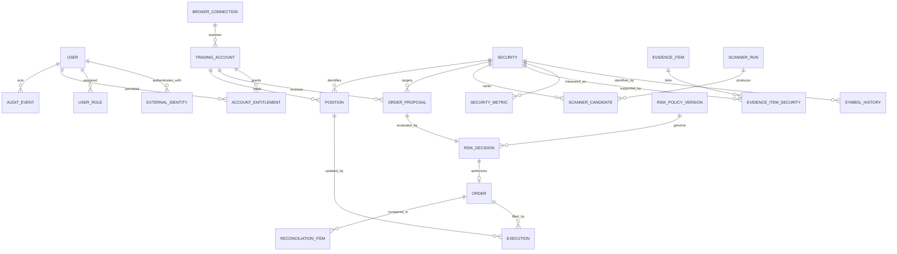
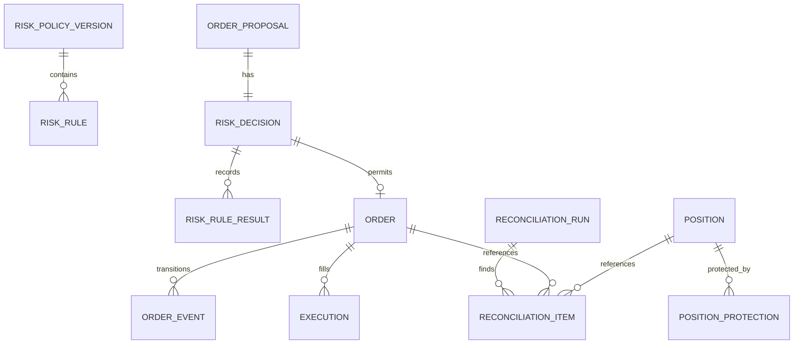

# MAKH Trading Platform — Logical Data Model

Last updated: 12 August 2026  
Status: Approved logical baseline for WBS 2.3

## 1. Design principles

- PostgreSQL 18 is the platform system of record; the broker remains authoritative for accepted orders, executions, live positions and buying power.
- Each business module owns a PostgreSQL schema and its writes. Cross-module writes and direct reporting reads of private tables are prohibited.
- Primary keys are application-generated UUIDs. External identifiers are stored separately with provider-qualified uniqueness.
- All instants use `timestamptz` in UTC; exchange-local dates and calendars are explicit fields, not inferred from server timezone.
- Monetary values use fixed-precision numeric types plus ISO currency; share quantities support required fractional precision but initial equities rules may enforce whole shares.
- Mutable aggregates use optimistic concurrency versions. Historical decisions, executions and audit events are append-only.
- Provider inputs retain source, provider event time, platform receipt time, schema/calculation version and quality state.
- JSONB is reserved for versioned provider/evidence payloads and extensible rule results; core query and integrity fields remain relational.
- Every tenant/account-scoped query is authorized in the application and indexed by account plus time/state as appropriate.

## 2. Schema ownership

| Schema | Owning module | Principal records |
|---|---|---|
| `iam` | Identity & Access | users, external identities, sessions, roles, grants, consents |
| `account` | Accounts & Connections | broker connections, trading accounts, account entitlements, provider status |
| `market` | Security Master & Market Data | venues, securities, symbol history, sessions, corporate actions, quotes, bars, metrics |
| `scanner` | Scanner & Watchlists | presets, runs, candidates, watchlists and items |
| `evidence` | Evidence & Catalysts | sources, evidence items, security links, verification and snapshots |
| `risk` | Risk & Policies | policy versions, rules, pauses, decisions, rule results and breaches |
| `trading` | Orders & Positions | proposals, orders, executions, positions, protections and reconciliation |
| `journal` | Journal & Reporting | trade entries, notes/tags, report jobs and export manifests |
| `notification` | Notifications | preferences, templates and delivery attempts |
| `audit` | Administration & Audit | append-only audit events, evidence manifests, administrative access |
| `platform` | Shared infrastructure | outbox, inbox, idempotency records, job leases and migration metadata |

EF Core may use one physical database and migration assembly, but each module has its own `DbContext` mapping and may write only its owned schema. Cross-module access uses application contracts or explicitly governed read models.

## 3. Core relationship view

## 4. Entity catalogue

### Identity and accounts

| Table | Purpose | Key constraints / notes |
|---|---|---|
| `iam.users` | Platform user profile and lifecycle | unique normalized subject mapping; soft-disabled, not reused |
| `iam.external_identities` | OIDC issuer/subject association | unique `(issuer, subject)`; no provider token columns |
| `iam.sessions` | Server-side session reference and expiry | hashed/opaque identifier; revoked/idle/absolute expiry; never store raw cookie |
| `iam.roles`, `iam.user_roles` | Platform role assignment | effective dates and assigner evidence |
| `iam.consents` | Terms/privacy/risk acknowledgement | unique user/document/version; acknowledged UTC and evidence hash |
| `account.broker_connections` | Provider connection metadata | environment/mode and encrypted secret reference; never raw password |
| `account.trading_accounts` | Canonical broker account reference | unique `(provider, provider_account_id, mode)`; mode is Paper or Live |
| `account.account_entitlements` | User/account/action entitlement | unique effective grant; live capability explicit and default denied |
| `account.provider_status` | Observed connection/account health | source time, observed time, state and version |

### Market, scanner and evidence

| Table | Purpose | Key constraints / notes |
|---|---|---|
| `market.venues` | Exchange/venue identity and timezone | unique MIC/provider mapping |
| `market.securities` | Canonical instrument identity | instrument type, venue, active/tradable state |
| `market.symbol_history` | Effective symbol mappings | non-overlapping effective range per venue/symbol/security |
| `market.market_sessions` | Trading calendar/session windows | unique venue/session date/type; UTC open/close |
| `market.corporate_actions` | Split, symbol and other actions | provider-qualified event ID; effective time/provenance |
| `market.quotes` | Normalized top-of-book observations | security/source/event/receipt time; bid ≤ ask when both valid |
| `market.bars` | Versioned OHLCV intervals | unique security/source/interval/start/version; corrected flag |
| `market.security_metrics` | RVOL, float, gain, spread/liquidity | value, unit, definition/calculation version, source and freshness |
| `scanner.presets` | Versioned filter/ranking configuration | owner/scope/version; immutable published version |
| `scanner.runs` | Scanner execution and input snapshot | preset version, as-of time, data-quality outcome |
| `scanner.candidates` | Ranked result per run/security | unique run/security; qualified flags and calculation evidence |
| `scanner.watchlists`, `scanner.watchlist_items` | User-curated lists | account/user scope; unique list/security active item |
| `evidence.sources` | Source identity, trust/licence class | permitted use/retention metadata |
| `evidence.items` | News, filing or social metadata | provider-qualified source ID; published/observed time; content hash |
| `evidence.item_securities` | Evidence-to-security association | unique item/security/relationship |
| `evidence.verifications` | Catalyst verification decisions | verifier/rule/version/reason; append-only |
| `evidence.snapshots` | Trade-linked evidence manifest | checksum, protected object reference, capture time |

### Risk, trading and reconciliation

| Table | Purpose | Key constraints / notes |
|---|---|---|
| `risk.policy_versions` | Effective immutable policy release | policy ID/version unique; non-overlapping effective period; status workflow |
| `risk.rules` | Versioned rule definitions | unique policy/rule code; type/operator/parameters validated |
| `risk.pauses` | System/account/symbol entry blocks | scope, reason, activation/expiry, actor; append activation history |
| `risk.decisions` | Immutable proposal-level outcome | unique proposal; digest, policy version, snapshot time, expiry, outcome |
| `risk.rule_results` | Rule-by-rule inputs and result | unique decision/rule; measured value, limit, result and reason |
| `risk.breaches` | Detected limit or health breach | severity/state; acknowledged/resolved through new events, not overwrite history |
| `trading.order_proposals` | Immutable canonical trader intent | unique `(account_id, client_request_id)`; proposal digest and mode |
| `trading.orders` | Canonical platform order aggregate | unique client order ID; provider order ID unique when known; state/version |
| `trading.order_events` | Append-only transition history | unique order/version and provider event identity where present |
| `trading.executions` | Broker-confirmed fill/fee facts | unique `(provider, account_id, provider_execution_id)`; no hard delete |
| `trading.positions` | Reconciled current position projection | unique account/security; quantity/version; not sole historical evidence |
| `trading.position_protections` | Exit/stop protection state | position/order linkage, desired versus broker-confirmed state |
| `trading.reconciliation_runs` | Broker comparison cycle | account, range, source snapshot/checksum and outcome |
| `trading.reconciliation_items` | Difference and resolution evidence | entity/type, platform/broker values, state, reason and resolution event |

### Journal, notifications, audit and platform

| Table | Purpose | Key constraints / notes |
|---|---|---|
| `journal.trade_entries` | Thesis, plan, review and outcome | user/account/security; links proposals/orders/positions |
| `journal.entry_tags` | Controlled/free-form categorization | unique entry/tag |
| `journal.report_jobs` | Authorized report generation | requester/scope/status/expiry |
| `journal.export_manifests` | Export scope, checksum and object reference | authorization/correlation/expiry; no embedded secret URL |
| `notification.preferences` | User/channel/severity choices | unique user/channel/event type |
| `notification.delivery_attempts` | Non-authoritative delivery record | provider receipt; idempotency key; redacted content reference |
| `audit.events` | Append-only security/business timeline | event ID, UTC, actor, account-safe scope, type, reason, correlation, payload hash |
| `audit.evidence_manifests` | Protected evidence object metadata | checksum, key version, classification, retention/hold state |
| `audit.privileged_access` | Elevation/break-glass evidence | reason, approver, start/expiry and revocation |
| `platform.outbox_messages` | Transactional event publication | unique message ID; aggregate/version; occurred/published/attempt data |
| `platform.inbox_messages` | At-least-once consumer deduplication | unique consumer/message; processed result/time |
| `platform.idempotency_records` | HTTP/application command replay control | unique scope/key; request hash, outcome reference, expiry |
| `platform.job_leases` | Distributed worker coordination | job key, owner, fencing token, lease expiry |

## 5. Transaction boundaries

- Proposal creation, risk decision, rule results and outbox fact commit in one database transaction.
- Order aggregate transition, order event and outbox fact commit together.
- Execution insertion is idempotent; execution effect and position projection update commit together using aggregate version checks.
- Reconciliation correction records source snapshot, reason and audit event in the same controlled workflow.
- External broker/data calls never participate in a database transaction. Pending intent commits first; workers call providers and reconcile results.

## 6. Read models and performance

Portal dashboards and reports use owned queries or explicitly maintained read models. They never become authoritative trading state. Candidate/order streams include monotonic versions so the Angular client can detect gaps and recover through REST snapshots.

Initial indexes target identity issuer/subject, account/time, security/time, order state/time, provider IDs, idempotency keys, outbox unpublished state, reconciliation state and evidence source IDs. Quote/bar partitioning and retention are selected only after volume/load evidence and vendor rights are known.

## 7. Open physical-design decisions

- Selected provider payload shapes, precision and permitted retention/redistribution.
- Expected quote/trade/bar volumes and whether time-series partitioning or an external licensed store is required.
- Managed PostgreSQL service, PITR window, cross-region requirements and encryption/key service.
- Final privacy/compliance retention obligations for the approved operating jurisdiction.
