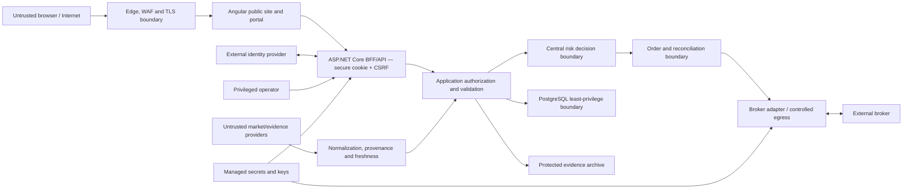

# MAKH Trading Platform — Threat Model

Last updated: 12 August 2026  
Status: Approved design baseline for WBS 2.2  
Method: STRIDE with abuse-case and trading-safety analysis

## 1. Scope and assumptions

The model covers the Angular public site and authenticated portal, ASP.NET Core API and SignalR hubs, workers, PostgreSQL, protected evidence archive, managed secrets, identity provider, market/evidence providers, broker integration and privileged operations.

It assumes a Clean Architecture modular monolith, a self-directed non-custodial platform, PostgreSQL authority for platform policy/intent/audit, broker authority for accepted orders/executions/live positions/buying power, centralized risk authority for new-order permission, and paper delivery before any separately approved live pilot. The public Internet, browsers, third-party payloads and client identifiers are untrusted.

Vendor-internal controls, physical security, insider screening and jurisdiction-specific compliance conclusions remain outside this design-stage review and require later evidence.

## 2. Security and safety properties

1. No broker submission occurs without an authenticated, authorized, account-scoped request and current immutable risk approval.
2. Repeated requests, retries or provider events create at most one intended broker order or execution effect.
3. Paper and live identities, accounts, credentials, configuration and presentation remain segregated.
4. Unknown, stale, conflicting or unavailable critical state blocks new opening/increasing orders.
5. Risk policies, kill-switch actions, credentials, exports and break-glass actions require privilege, appropriate MFA freshness and audit evidence.
6. Market, news and social content is untrusted evidence; social activity never independently authorizes an order.
7. Order, execution, policy, risk-decision and audit history cannot be silently rewritten or hard-deleted.
8. A material trading action can be reconstructed from actor and evidence through broker outcome.

## 3. Assets and impact

| Asset | Required property | Failure impact |
|---|---|---|
| Identity and session | Authenticity, confidentiality, revocability | Account takeover; unauthorized orders/policy changes |
| Account/live entitlement | Correct subject/account/mode binding | Cross-account or unauthorized live trading |
| Risk policies/decisions | Integrity, versioning, availability | Hard-limit bypass or false rejection |
| Order intent/idempotency keys | Integrity, uniqueness, traceability | Duplicate, altered or repudiated orders |
| Broker credentials/tokens | Confidentiality, rotation, least privilege | Direct external account compromise |
| Broker order/execution state | Authenticity, integrity, freshness | Wrong exposure, protection or P&L decisions |
| Market/reference data | Integrity, provenance, freshness | Unsafe sizing, tradability or liquidity decisions |
| News/filing/social evidence | Provenance, trust classification | Manipulated ranking or false catalyst |
| Audit/evidence archive | Append-only integrity, availability | Investigation and proof failure |
| Personal/account data | Confidentiality, minimization | Privacy, fraud and compliance harm |
| Kill switch/pause state | Integrity, availability, priority | Failure to contain trading risk |
| Supply chain/configuration | Integrity, provenance | System-wide compromise or control bypass |

## 4. Trust boundaries

Boundary rules:

- Browser state is never authoritative for authorization, price freshness, risk approval or order state.
- Every API and SignalR operation establishes identity, policy and resource/account scope server-side.
- Provider inputs are validated, normalized and tagged with source and observation time before use.
- Risk approval is bound to proposal digest, account, mode, policy version, market snapshot and expiry.
- Broker writes are reachable only through the order application path and broker port.
- Database/archive access uses separate least-privilege workload identities; privileged access is time-limited and audited.

## 5. Risk rating

Likelihood and impact use a 1–5 scale; score is likelihood × impact.

| Score | Rating | Treatment |
|---:|---|---|
| 20–25 | Critical | Block release until reduced and independently verified |
| 12–19 | High | Named owner, tested mitigation and release evidence |
| 6–11 | Medium | Control and verification before the exposed feature ships |
| 1–5 | Low | Accept, monitor or improve through normal backlog |

Residual ratings assume all listed controls operate as designed. Missing controls restore the inherent rating.

## 6. Threat register

| ID | STRIDE | Threat / abuse case | Inherent | Required controls | Residual | Owner |
|---|---|---|---:|---|---:|---|
| TM-01 | S/E | Stolen or replayed session submits orders or changes policy | 25 Critical | OIDC code+PKCE through BFF; HttpOnly Secure SameSite cookie; rotation/revocation; MFA freshness; anomaly alerts | 10 Medium | Identity/Security |
| TM-02 | E | User crosses role/account boundary | 25 Critical | Default-deny policy/resource authorization on every API/hub; server-derived account; deny tests | 5 Low | API/Security |
| TM-03 | T/E | Client bypasses or alters risk approval before submission | 25 Critical | Server-only evaluation; immutable bound decision; expiry; atomic commit; order verifies binding | 5 Low | Risk/Orders |
| TM-04 | T/R | Duplicate request, timeout retry or race creates multiple orders | 25 Critical | Unique IDs; idempotency store; transaction/locking; query-before-retry; reconciliation | 5 Low | Orders |
| TM-05 | T | Forged, duplicate or out-of-order broker event corrupts state | 25 Critical | Authenticated event transport; execution uniqueness; versions; inbox dedupe; reconciliation | 10 Medium | Broker/Orders |
| TM-06 | T | Price, float, session or corporate-action data is spoofed/stale | 20 Critical | Provider auth; canonical IDs; provenance/time; validation; stale gates; quarantine; fail closed | 10 Medium | Data/Risk |
| TM-07 | T | Manipulated news/social content fabricates a catalyst | 20 Critical | Source trust classes; filing/issuer verification; snapshot; social never authorizes orders | 8 Medium | Evidence/Product |
| TM-08 | E/T | Live mode/credentials enabled by configuration mistake | 25 Critical | Separate accounts/credentials/config; default-deny live entitlement; approvals; startup assertions | 5 Low | Platform/Ops |
| TM-09 | E/R | Unauthorized policy, pause or kill-switch change | 25 Critical | Separate roles; step-up MFA; confirmation/reason; effective versions; append-only audit/alerts | 5 Low | Risk Admin/Security |
| TM-10 | I | Broker token, personal data or payload leaks | 20 Critical | Managed secrets; token protection; redaction/minimization; analytics denylist; scoped exports | 8 Medium | Platform/Security |
| TM-11 | R/T | Audit evidence is altered, deleted or uncorrelated | 20 Critical | Append-only events; restricted delete; checksum/archive; time sync; correlation; restore tests | 5 Low | Audit/Ops |
| TM-12 | D | DDoS, rate exhaustion or outage prevents control | 20 Critical | Rate limits; bounded queues; breakers; isolation; health gates; entry fail-close; runbooks | 10 Medium | Platform/Ops |
| TM-13 | S/T | CSRF, XSS or malicious extension performs action | 20 Critical | SameSite; anti-forgery; origin checks; CSP/encoding; no browser token storage | 8 Medium | Frontend/API |
| TM-14 | E/I | Injection, mass assignment or unsafe deserialization | 20 Critical | Parameterized persistence; explicit DTOs; schema/size validation; least-privilege DB; SAST/DAST | 5 Low | API/Data |
| TM-15 | E/T | Compromised dependency/build/deploy changes controls | 25 Critical | Protected review; signed/attested artifacts; locks; SAST/SCA/secrets; SBOM; approvals | 10 Medium | Engineering/Security |
| TM-16 | E/R | Insider or stolen admin abuses break-glass | 20 Critical | No standing privilege; time-bound elevation; MFA; reason/ticket; alerts/review | 8 Medium | Security/Ops |
| TM-17 | I/E | Report/export exposes another account | 20 Critical | Resource authorization; scoped queries; export manifest/expiry/rate limit; negative tests | 5 Low | Reporting/Security |
| TM-18 | T/D | Clock drift invalidates freshness, policy or sequence | 16 High | UTC; trusted time; source timestamps; drift alarms; market calendar; injected-clock tests | 4 Low | Platform/Data |
| TM-19 | D/T | Reconciliation backlog/mismatch leaves exposure unknown | 25 Critical | Priority queues; mismatch lockout; full reconciliation; alerts; no entries while unknown | 10 Medium | Orders/Ops |
| TM-20 | T/E | Flag, cached decision or alternate endpoint bypasses safety | 25 Critical | One submission contract; architecture tests; server gates; no cached auth/risk truth; inventory | 5 Low | Architecture/Security |

## 7. Priority abuse cases

- **AC-S01 — stolen session:** deny live action without entitlement and fresh MFA; resolve account/mode server-side; support revocation and alerts.
- **AC-S02 — proposal replay:** idempotency and a consumed/expired proposal-bound decision return the original outcome or reject; never create a second broker order.
- **AC-S03 — post-approval alteration:** a changed price, quantity, account or mode changes the canonical digest and requires fresh risk evaluation.
- **AC-S04 — broker timeout:** record unknown/pending reconciliation, query by stable client-order ID and never blindly resubmit.
- **AC-S05 — social manipulation:** retain social input as low-trust metadata; require approved verified evidence; scanner cannot invoke broker submission.
- **AC-S06 — hard-limit weakening:** require privilege, fresh MFA, reason, effective-dated immutable version and applicable non-bypassable ceiling.
- **AC-S07 — liquidation abuse:** show impact, require fresh MFA and second confirmation, issue idempotent close commands and reconcile every outcome.
- **AC-S08 — cross-account access:** deny modified IDs, hub groups and export filters through server-side resource authorization without existence leakage.

## 8. Data-flow rules

- Browser: opaque host-scoped session cookie only; server-side tokens; anti-forgery on mutations; authorized SignalR groups; no-store sensitive responses.
- Ingestion: provider, event/receipt times, schema/calculation version and quality state retained; invalid records quarantined; freshness is a risk input.
- Risk/orders: decision binds immutable proposal, policy, snapshot, calculations, outcome and expiry; submission rechecks authorization, mode, kill switch and reconciliation health.
- Broker: managed least-privilege paper/live credentials; controlled egress; signatures/replay windows where available; redacted provider payloads.
- Administration/audit: privileged changes record reason/correlation/before-after versions; break glass expires; export access is scoped and audited.

## 9. Review triggers

Review when selecting/changing identity, broker, data or hosting providers; adding a webhook/order type/live automation/multiple users; extracting a service; changing secrets/network/retention; or responding to an incident or test finding.
